# PRIX: evidence-graded smart index layer for NEAR

PRIX is a read-only analytics app for NEAR's on-chain markets. It reads pools from RHEA (formerly Ref Finance), NEAR Intents balances and flows, and NEAR network history. It then:

- rejects liquidity it cannot verify;
- ranks NEAR tokens on **depth, real activity, holder distribution and flows**;
- tests six pre-registered, falsifiable investment claims about NEAR against published, hashed daily snapshots.

Every number links to its source. A missing input is shown as "not reported", never estimated.

Built for **NEAR HACKATHON 2026**, track **Investment Thesis** (`thesis`).

> No wallet, no signing, no trading, no custody, no private keys. PRIX only reads public data.

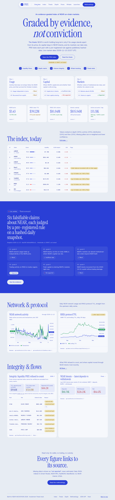

## The problem it solves

Holding a NEAR token means answering four questions. Can I exit without moving the price? Is the volume real? Who owns the supply? Is capital coming in or leaving? The raw data exists, but it is scattered, and much of it is misleading. For example, on 13 Nov 2026 a single RHEA pool reported about $683M of TVL, more than 10× the whole protocol. PRIX recomputes everything from reserves. It discards what fails integrity rules and shows its inputs, so an analyst can defend a position with evidence rather than conviction.


## Re-run this in 3 commands

```bash
pnpm install --frozen-lockfile
pnpm verdicts      # offline: verdicts H1–H6 from the latest data/snapshots/*.json (checks its sha256)
pnpm verify        # online: refetch every source, rebuild in memory, diff against the published snapshot → PASS or the diff
```

`pnpm verdicts --snapshot data/snapshots/2026-11-13.json` pins a specific file. `pnpm verify --offline` skips the
refetch; `--tolerance 0.10` (point-in-time values) and `--history-tolerance 0.01` (days before the snapshot) set the
allowed drift; `--allow-verdict-drift` reports but does not fail on a changed verdict. Thresholds come from
`thresholds/v1.yaml` (**DRAFT, not locked**, see `docs/threshold-diff.md`). A standard-library Python cross-check of the hash and of H2/H3/H6 is in `notebooks/rerun.ipynb`.

## Try it (judge walkthrough)

Run it locally with the steps below, or use the hosted URL once it is deployed.

1. **Open `/`** for the one-sentence thesis and its three pillars (usage, capital, markets) linked to the six claims, the market pulse, the top of the PRIX Index (high-confidence tokens only), TVL with and without the rejected pools, and the six-claim scorecard.
2. **Open `/rankings`** for every token in the universe with its composite score, four pillar scores, confidence, $10k price impact, top-10 holder share of float, buy pressure and flags.
3. **Click any token** (for example RHEA). Each pillar lists its exact inputs with a `src ↗` link to the API call that produced it. You also get the pool's 90-day TVL and volume chart, its top holders (custody contracts are labelled), and every RHEA pool containing the token, including the ones PRIX rejected and why.
4. **Open `/thesis`** to see the six pre-registered claims: verdict, metric vs threshold, margin to the next verdict, evidence grade, window, sample size, flip condition and snapshot hashes, plus a before/after panel around the 2026-10-01 NEAR Intents exploit.
4b. **Open `/depth`** for the depth matrix: 1Click dry-run quotes (BTC/ETH/SOL → token) and RHEA router quotes (token → USDC) at $1k/$10k/$100k/$1M, with every failed, paused or rate-limited quote shown.
5. **Open `/whales`** to see swaps and liquidity moves of $10k or more, each traced to its transaction and signer on nearblocks.io.
6. **Open `/flows`** for sampled NEAR Intents flows over 24h/7d/30d with event counts, sector liquidity, per-token buy and sell pressure, NEAR Intents deposits and withdrawals by asset and origin chain, and the assets held by `intents.near`.
7. **Open `/launches`** for new tokens from the newest RHEA pools, scored on liquidity, distribution, activity and age, with the creator account.
8. **Run `pnpm verdicts` and `pnpm verify`** (above).
9. **Call the API**: `curl localhost:3000/api/v1/index | jq '.rows[0]'`.

## How NEAR is used

- **RHEA**: the AMM pool reserves, prices, swap and liquidity events and daily pool history come from the RHEA indexer and data service. DCL (concentrated-liquidity) pool reserves are read **directly from the `dclv2.ref-labs.near` contract** over NEAR RPC. Price impact comes from read-only **RHEA Smart Router** quotes.
- **NEAR Intents**: PRIX reads the balances held by `intents.near` (FastNEAR) and the latest MINT/BURN events (deposits and withdrawals, from NearBlocks v3). It also uses the **1Click** token list as an independent price to cross-check RHEA prices.
- **NEAR protocol**: `ft_total_supply` via RPC, top holders from FastNEAR, and daily transactions, active accounts and price from NearBlocks v3. Receipts are resolved to transactions and signers.

## Methodology (summary)

Full detail is on `/methodology` and in [docs/PRD.md](docs/PRD.md).

**Integrity.** A pool is excluded when:
- a side has no price;
- a 50/50 AMM pool's sides differ by more than 3×;
- it has no base asset (NEAR, stablecoin, liquid-staked NEAR, or a curated bridged major); or
- it claims more than 50% of RHEA's total TVL.

Pools under $1k are dust.

**PRIX score** (0–100) is the weighted mean of the available pillars:

| Pillar | Weight | Measure |
|---|---|---|
| Depth | 30% | Price impact plus fees of a $10k sell into USDC (RHEA Smart Router, or AMM math as a fallback). 0.3% scores 100 and 10% scores 0, on a log scale |
| Activity | 25% | 24h clean volume, log-scaled from $1k to $100M. Capped at 50 for turnover above 5×/day or round trips above 30% |
| Distribution | 20% | Share of float held by the top 10 non-custody holders. 20% scores 100 and 90% scores 0 |
| Flow | 25% | Net buy pressure in the last 50 swaps, plus 7-day pool TVL change and 7-day vs 30-day volume |

**Confidence** is the share of weight with data. Below 50%, a token is listed but not ranked.

**Thesis rules** are in the table on `/thesis` and in the PRD §3.

## Data sources

All sources are public and need no key. They were verified on 13 Nov 2026.

| Source | Used for |
|---|---|
| `api.rhea.finance` (RHEA indexer) | pools, prices, token metadata, swaps and liquidity events, DCL volume and TVL history |
| `api.data-service.ref.finance/api` | protocol TVL history, per-pool daily TVL and volume |
| `smartrouter.rhea.finance/findPath` | read-only route quotes for price impact |
| `free.rpc.fastnear.com` (NEAR RPC) | `dclv2.ref-labs.near list_pools`, `ft_total_supply` |
| `api.fastnear.com` | top holders, `intents.near` balances |
| `api.nearblocks.io/v3` | network history, receipt → tx → signer, account creation, Intents events |
| `1click.chaindefuser.com/v0/tokens` | independent price cross-check |

- **NEAR Intents 1Click quotes**: `POST /v0/quote` with `dry: true` (no deposit address is returned, nothing can be sent) measures what BTC/ETH/SOL → token orders would cost at four sizes.
- **Archival RPC**: `ft_balance_of(intents.near)` at the first block of each UTC day since 2026-09-19 for the H6 recovery test.

The RHEA aggregator V2 (`@rhea-finance/cross-chain-aggregation-dex` `SwapClient`) needs a JWT from boss.rhea.finance; set `RHEA_AGGREGATOR_API_KEY` to enable it. See `docs/sdk-notes.md`.

## Setup

Requires Node 20.9+ and pnpm.

```bash
pnpm install
cp .env.example .env.local   # optional: every variable is optional
pnpm build && pnpm start     # http://localhost:3000
pnpm test                    # vitest: engine fixtures, depth math, thresholds, hashing
pnpm snapshot:daily          # build data/snapshots/<UTC date>.json (what the daily GitHub Action runs)
pnpm flows                   # sample NEAR Intents flow buckets into data/history/
```

The first build pre-renders every page from live data, which takes about 1 minute on a cold cache. Pages then revalidate every 5–10 minutes.

### Environment variables (all optional, server-side only)

| Variable | Purpose |
|---|---|
| `NEARBLOCKS_API_KEY` | Raises NearBlocks rate limits. Recommended for a hosted demo, since the free tier can return 429 under load. Any section that hits the limit shows "not reported" |
| `ONECLICK_API_KEY` / `ONECLICK_JWT` | 1Click partner key (X-API-Key) or legacy JWT (Bearer) from partners.near-intents.org. Removes the 20 bps unauthenticated fee and raises limits; dry quotes work without it |
| `RHEA_AGGREGATOR_API_KEY` | RHEA aggregator V2 JWT from boss.rhea.finance (not wired until verified; reported as not configured) |
| `NEAR_ARCHIVAL_RPC_URL` | Archival RPC override (default archival-rpc.mainnet.fastnear.com) |
| `NEAR_RPC_URL`, `RHEA_INDEXER_URL`, `RHEA_DATA_SERVICE_URL`, `RHEA_SMART_ROUTER_URL`, `NEARBLOCKS_API_URL`, `FASTNEAR_API_URL`, `ONECLICK_API_URL` | Endpoint overrides |

No database is required.

### Deploy to Vercel

1. Import the repo into a Vercel project (framework: Next.js; defaults are fine).
2. Optionally add `NEARBLOCKS_API_KEY` as a Sensitive environment variable for Production.
3. Deploy. No database is needed. Snapshots are committed to `data/snapshots/` by the `daily snapshot` GitHub Action (00:20 UTC); the `intents flow buckets` Action samples flows every 30 minutes into `data/history/` (these commits skip the Vercel build via `vercel.json`'s `ignoreCommand`).

## Public API

| Endpoint | Returns |
|---|---|
| `GET /api/v1/index` | ranked index with every pillar input and source |
| `GET /api/v1/token/{contract}` | one token's evidence row and pools |
| `GET /api/v1/flows` | sector liquidity, token pressure, Intents flows and custody |
| `GET /api/v1/whales` | whale swaps, LP moves, accounts |
| `GET /api/v1/launches` | launch radar |
| `GET /api/v1/thesis` | verdicts H1–H6 from the latest snapshot (envelope) |
| `GET /api/v1/depth?token=&size=` | depth matrix rows (envelope) |
| `GET /api/v1/integrity` | TVL with and without rejected pools (envelope) |
| `GET /api/v1/history?claim=H1` | one claim across all snapshots + its series (envelope) |
| `GET /api/v1/snapshots`, `/api/v1/snapshots/{date}` | published snapshot files |
| `GET /api/v1/openapi.json` | OpenAPI 3.1 |
| `GET /feed.xml` | Atom feed: one entry per verdict change |

Envelope: `{as_of, methodology_version, thresholds_version, thresholds_status, source_hash, data}`; `source_hash` is the snapshot file's `sha256`.

## Design system

The UI follows a light editorial design language (a Framer portfolio template was used only as a visual reference; no content, images or branding were taken). Tokens are in `app/globals.css`.

| Token | Value | Use |
| --- | --- | --- |
| Display font | Instrument Serif 400, tracking −0.02em, line-height ~0.98 | page titles (42/56/64px), section heads (44–72px), card titles (26–28px), stat values (30–40px) |
| Text font | Host Grotesk 400/500 | body 15–17px, nav 16px, buttons 16px/500 |
| Numeric font | Geist Mono, tabular figures | table values, IDs |
| Paper / card / raised | `#e7ecf3` / `#f6f8fc` / `#fbfcfe` | page, cards, row hover |
| Ink | `#2a3fd6` (cobalt), `#16218a` (dense data), `#4f5fc2` (secondary), `#5865bd` (tertiary) | all text ≥4.5:1 on cards |
| Semantic | up `#157a46`, warn `#8a5a00` on `#f1e4a6`, down `#b42a36`, dots `#1e9e5a` / `#ff6b6b` | deltas, verdicts, flags |
| Lines | `rgba(42,63,214,.12)` hairline, `.28` strong | table rows, chip outlines, footer rule |
| Radii | cards 20px, tiles 16px, chips 14px, number keys 8px, pills 100px; bubbles 20/20/20/6 and 20/20/6/20 | |
| Shadow | nav pill `0 8px 24px rgba(42,63,214,.1)`, menu `0 24px 48px rgba(12,20,90,.18)` | |
| Motion | appear: opacity + 14px rise + 4px blur, 0.7s `cubic-bezier(.23,1,.32,1)`; 0.3s colour hovers; off under `prefers-reduced-motion` | |

## Project structure

```
app/                 pages (App Router) and /api/v1 routes
components/          UI primitives, Lightweight Charts wrapper, navigation
lib/sources/         typed clients for RHEA, NEAR RPC, FastNEAR, NearBlocks v3, 1Click
lib/model/           deterministic live models: market+integrity, index (+ thresholds rules), flows, whales, launches, network
lib/thresholds/      thresholds/v1.yaml schema (zod), rule compiler
lib/thesis/          pure verdict engine H1–H6 + statistics
lib/depth/           1Click dry-quote matrix, RHEA router depth, slippage maths
lib/snapshot/        snapshot schema, canonical hash, builder, file IO
lib/history/         archival custody and sampled flow-bucket histories (data/history)
scripts/             snapshot-daily, flows-sample, verdicts, verify, check-thresholds
thresholds/v1.yaml   pre-registered thresholds (DRAFT)
data/snapshots/      published daily snapshots
tests/               vitest
docs/PRD.md          full product requirements and methodology
screenshots/         380px and 1280px captures of every page
```

## Known limits

- Swap and Intents samples cover short, stated windows (minutes to hours). They describe the present, not a trend.
- The RHEA indexer does not expose swap signers, so PRIX resolves them only for the largest events.
- Pool TVL change is measured in USD and includes price moves.
- FastNEAR returns up to 100 holders; larger holder bases show as "100+".
- Venues other than RHEA and NEAR Intents are not covered.

## Hackathon disclosure

- Everything in this repository was written during NEAR HACKATHON 2026, starting 13 Nov 2026. There is no pre-hackathon baseline.
- Libraries used: Next.js 16, React 19, Tailwind CSS 4, TradingView Lightweight Charts 5, Google Fonts via `next/font` (Instrument Serif, Host Grotesk, Geist Mono — all SIL OFL), `server-only`, and tsx (dev, for the CLI). The code was written with AI assistance.
- License: MIT (see [LICENSE](LICENSE)).

## Screenshots

| Page | 1280px | 380px |
|---|---|---|
| Overview |  |  |
| PRIX Index | 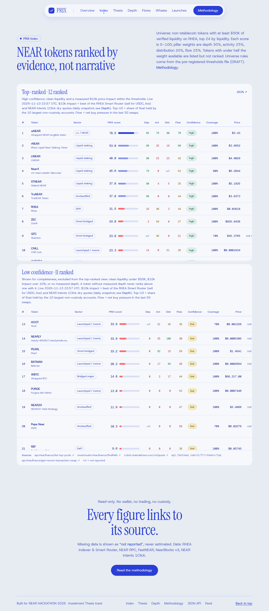 | 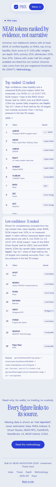 |
| Thesis | 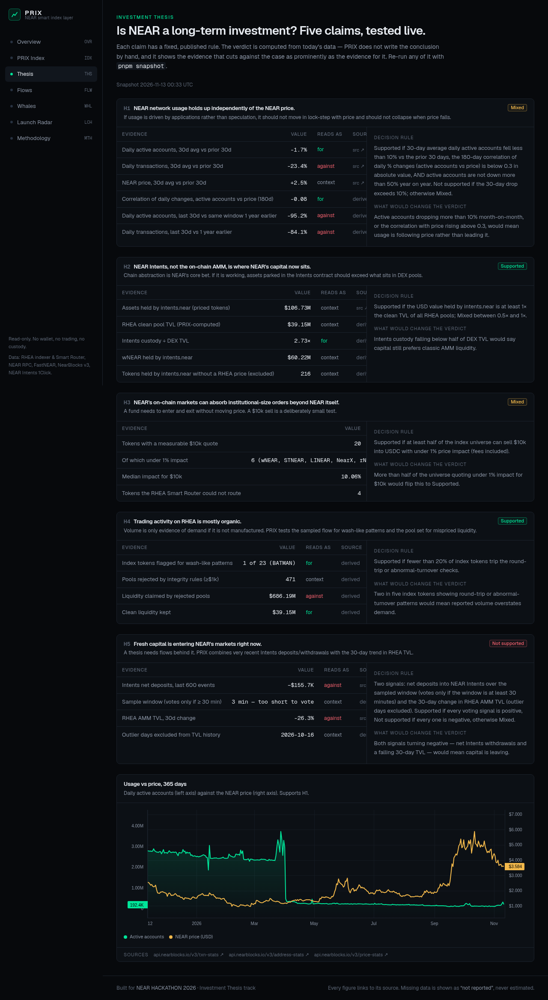 |  |
| Flows | 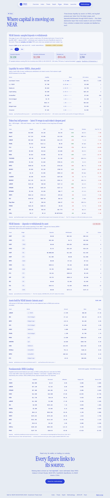 |  |
| Whales | 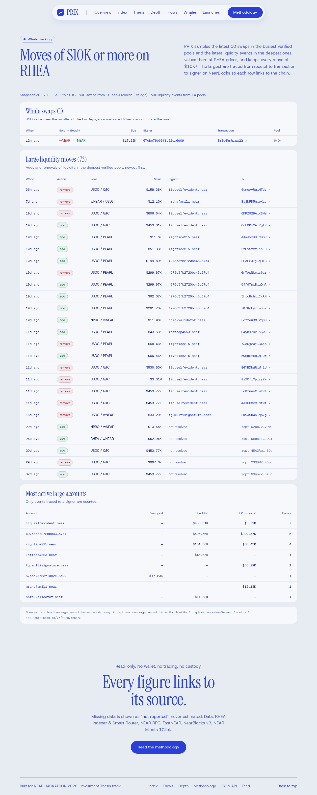 | 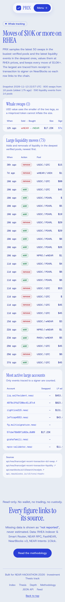 |
| Launch radar | 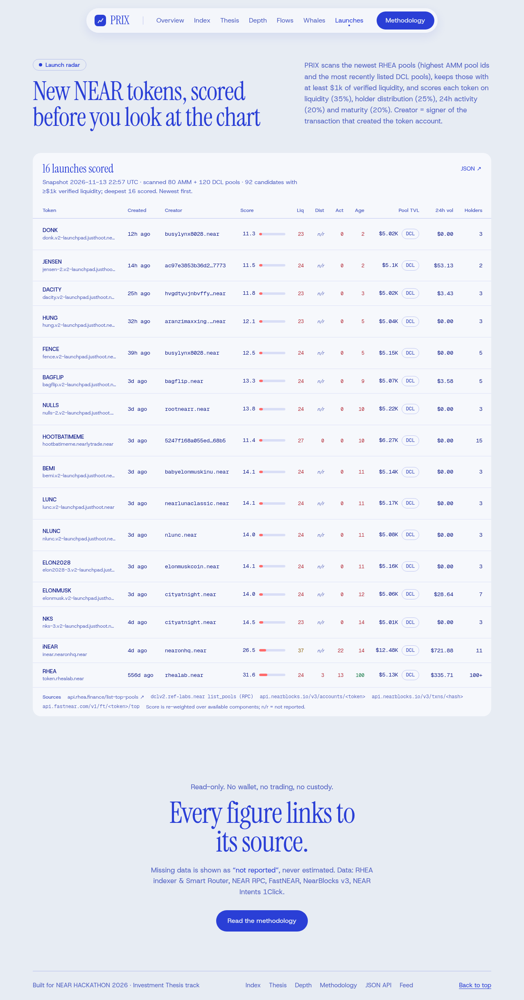 | 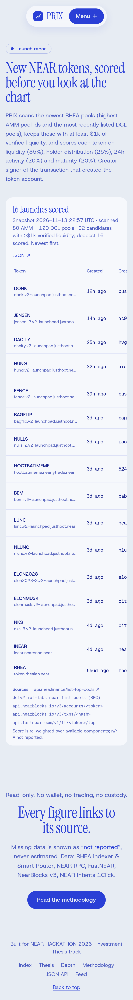 |
| Token detail (RHEA) | 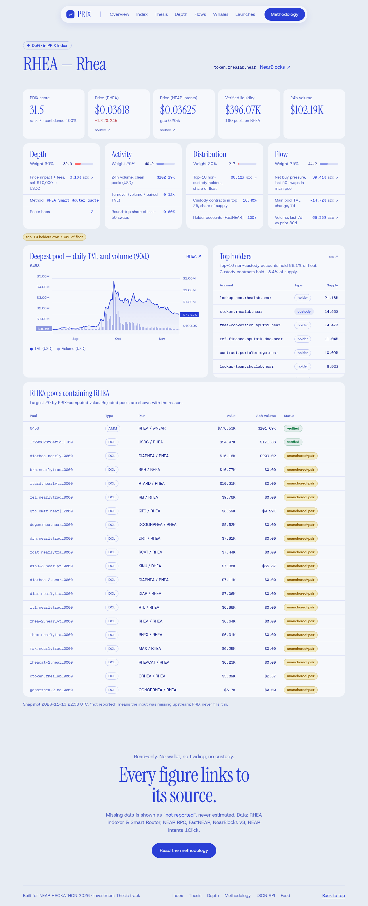 | 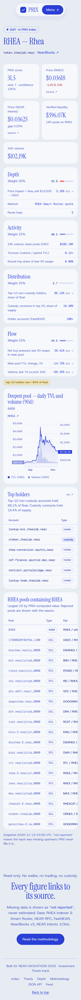 |
| Methodology | 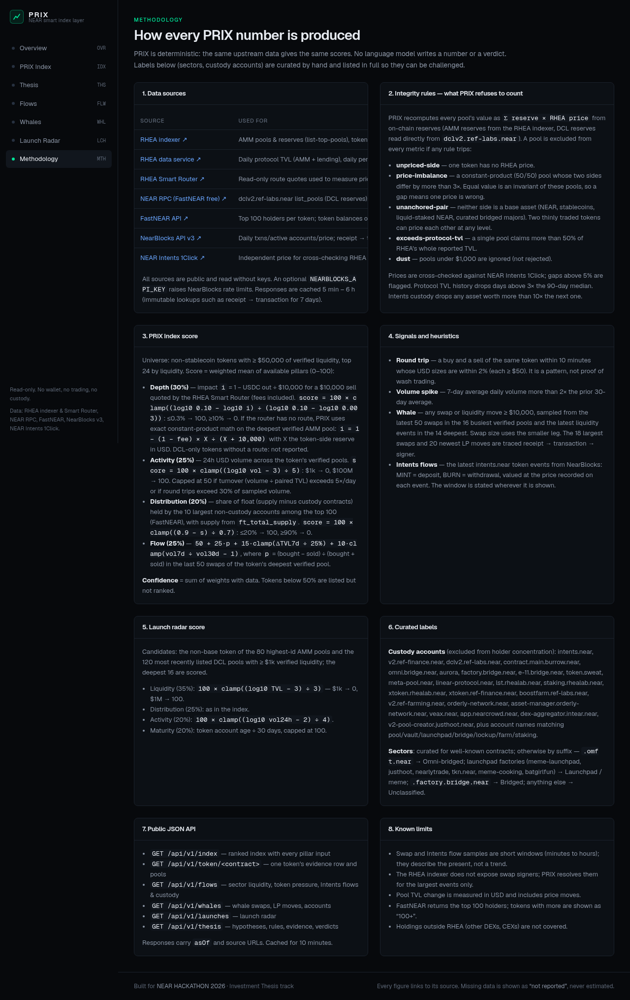 |  |
